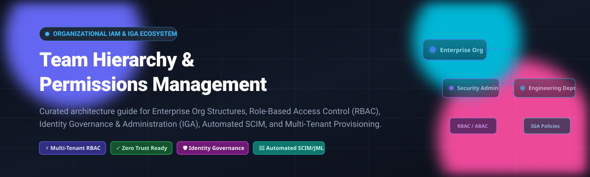

  

# 🏢 Awesome Team Hierarchy & Permissions Management 🛡️

  
  
  
  
  
  

---

## 🌟 Overview & Architecture

An authoritative, SEO-optimized curated directory of enterprise **SaaS Platforms** and battle-tested **Open-Source GitHub Repositories** for **Team Hierarchy & Permissions Management**, **Role-Based Access Control (RBAC)**, **Attribute-Based Access Control (ABAC)**, and **Identity Governance and Administration (IGA)**.

Whether you are architecting a multi-tenant B2B SaaS platform, structuring fine-grained departmental reporting trees, automating Joiner-Mover-Leaver (JML) provisioning with SCIM, or enforcing Zero Trust access audits, this repository provides complete pricing transparency, market analytics, and source references.

### 📑 Table of Contents
- [📊 Sector Overview & Market Dynamics](#-sector-overview--market-dynamics)
- [☁️ SaaS & Hosted Platforms](#️-saashosted-platforms)
- [🔓 Open-Source GitHub Projects](#-open-source-github-projects)
- [📈 Star History](#-star-history)
- [🤝 How to Contribute](#-how-to-contribute)
- [☕ Support](#-support)
- [⚖️ Disclaimer](#️-disclaimer)

---

## 📊 Sector Overview & Market Dynamics

The global Identity & Access Management (IAM) and Identity Governance & Administration (IGA) sector is projected to reach **$24.3 billion to $29.7 billion by 2026**, expanding at a robust Compound Annual Growth Rate (CAGR) of approximately **11% to 15%** toward $60+ billion in the early 2030s.

The market structure is **moderately fragmented**: while a concentrated core of tech behemoths (Microsoft, Okta, Workday, Ping Identity) commands massive enterprise identity estates, rapid migration to microservices, multi-cloud sprawl, and AI agent permissions has catalyzed high fragmentation with hundreds of specialized vendors and agile open-source engines competing across fine-grained authorization, CIAM, and just-in-time access requests.

---

## ☁️ SaaS/Hosted Platforms

The following table evaluates top commercial SaaS solutions for team hierarchy modeling, workforce identity, HRMS data foundations, and access governance. Entries are ranked in descending order of enterprise scale (valuation / market capitalization).

| 🏢 Platform | 💰 Company Valuation / Market Cap | 🏷️ Starting Paid Tier Pricing | 🎁 Free Tier / Trial Limit | 🔑 Key Architectural Capabilities |
| :--- | :--- | :--- | :--- | :--- |
| **[Microsoft Entra ID](https://www.microsoft.com/en-us/security/business/microsoft-entra)** | **$3.1 Trillion** *(Microsoft Parent Market Cap)* | **$7.00** per user/month (Entra ID P1 annual commitment); Entra ID P2 at **$10.00** per user/month | **Free Forever** included with Azure/M365 accounts (capped at 50k External ID MAUs, basic directory sync, core MFA; no Conditional Access or PIM) | Cloud identity directory, dynamic user/group lifecycle workflows, entitlement management, SCIM connectors, and Privileged Identity Management (PIM). |
| **[Workday](https://www.workday.com/)** | **~$52.0 Billion** *(Public Market Cap: WDAY)* | **$34.00 – $60.00** PEPM (typical core HCM enterprise starting band, quote-based multi-year) | **No Free Plan**; 30-day guided enterprise sandbox/demo environment with sales consultation | Global enterprise HCM and ERP authoritative source for supervisory hierarchies, cost centers, matrix reporting, and HR-driven onboarding triggers. |
| **[Okta](https://www.okta.com/)** | **~$37.0 Billion** *(Public Market Cap: OKTA)* | **$6.00** per user/month (Workforce Starter Suite, billed annually with $1,500 annual contract minimum) | **30-Day Free Trial** (restricted to 100 users, sandbox integrations and core MFA testing) | Universal Directory, automated SCIM provisioning across 7,000+ apps, Access Certifications, lifecycle rules, and Workflows engine. |
| **[Rippling](https://www.rippling.com/)** | **$16.8 Billion** *(Series G Valuation)* | **$8.00** per employee/month (plus $40.00/month flat base platform fee) | **No Permanent Free Plan**; targeted 14-day free trial on IT & Device Management module (demo required for full suite) | Unified Employee Graph synchronizing reporting hierarchy, dynamic app assignment rules, automated onboarding/offboarding, and IT hardware management. |
| **[HubSpot](https://www.hubspot.com/)** | **~$12.5 Billion** *(Public Market Cap: HUBS)* | **$15.00** per seat/month (Starter Edition billed annually; $20/month billed monthly) | **Free Forever** capped at 2 seats, up to 1,000 marketing contacts, and basic CRM permissions (HubSpot branding enforced) | Role-based permission sets, team hierarchy structuring (hierarchical parent-child teams available on Pro/Enterprise), and audit logs. |
| **[Ping Identity](https://www.pingidentity.com/)** | **$2.8 Billion** *(Acquired by Thoma Bravo)* | **$3.00** per user/month (PingOne Workforce Essentials base starting tier, annual commitment) | **30-Day Free Trial** (full-featured cloud tenant sandbox with SSO, MFA, and directory connector testing) | Enterprise federation, decentralized identity, risk-aware adaptive access, and automated employee provisioning integrated with ForgeRock technology. |
| **[JumpCloud](https://jumpcloud.com/)** | **$2.6 Billion** *(Series F Valuation)* | **$9.00** per user/month (Core Directory Package billed annually; $11/mo monthly) | **30-Day Free Trial** with full platform capabilities, transitioning to a free tier capped at 10 users and 10 devices | Cloud Directory Platform with Directory-as-a-Service, LDAP/SAML endpoints, cross-OS device MDM, and automated JML provisioning. |
| **[BambooHR](https://www.bamboohr.com/)** | **$2.5 Billion** *(Providence Equity Valuation)* | **$10.25** per employee/month (Essentials tier; flat minimum starting at $250/mo for companies <25 employees) | **7-Day Free Trial** (complete access to core HRIS dashboard, employee profiles, and workflow testing without credit card) | Centralized employee database, visual organizational charts, reporting structures, and webhooks feeding downstream IAM directories. |
| **[OneLogin](https://www.onelogin.com/)** | **~$800 Million** *(Estimated acquisition value by One Identity)* | **$4.00** per user/month (Advanced Directory & SSO package, billed annually) | **30-Day Free Trial** (full access for evaluation up to 25 users across cloud apps) | Real-time Active Directory sync, smart factor authentication, role-driven entitlement mapping, and unified app catalog. |
| **[Lumos](https://www.lumos.com/)** | **~$200 Million** *(Series B Valuation)* | **$27,000.00** annual core platform base commitment (plus ~$15.00 per user/month or $180/user/year) | **No Self-Serve Free Tier**; 14-day coordinated sandbox proof-of-concept and free SaaS discovery risk assessment | Modern app access request portal, Slack/Teams conversational approvals, time-bound emergency privilege elevation, and auto-SCIM provisioning. |

---

## 🔓 Open-Source GitHub Projects

Curated self-hosted engines and frameworks for implementing hierarchical multi-tenancy, Role-Based Access Control (RBAC), ReBAC (Relationship-Based Access Control), and Identity Governance. Repositories are ranked in descending order of GitHub community stars.

| 📦 Repository & Badge | ⭐ GitHub Stars | 📜 License | 🎯 Primary Architecture Focus | 🛠️ Key Capabilities & Hierarchy Support |
| :--- | :--- | :--- | :--- | :--- |
| **[Keycloak](https://github.com/keycloak/keycloak)**    | **37,600+** | Apache-2.0 | Multi-Tenant IAM & Enterprise SSO | Features **Organization Groups** (introduced in Keycloak 26.6+) enabling nested organizational hierarchies (`/Corp/Engineering/DevOps`) isolated per tenant, claim-based auto group mapping, OIDC/SAML assertions, and LDAP federation. |
| **[Authelia](https://github.com/authelia/authelia)**    | **29,400+** | Apache-2.0 | Lightweight Reverse Proxy Auth & 2FA | Companion authentication and authorization portal protecting web applications behind reverse proxies (Nginx, Traefik, Envoy) with group-based policy rules, Duo/FIDO2 MFA, and LDAP/file-based user backend. |
| **[Casbin](https://github.com/casbin/casbin)**    | **20,400+** | Apache-2.0 | Multi-Model Authorization Engine | Supports Classic ACL, RBAC with hierarchical role inheritance, ABAC, and RESTful path matching across 10+ programming languages. Perfect for embedding fine-grained permissions directly into application microservices. |
| **[ZITADEL](https://github.com/zitadel/zitadel)**    | **15,400+** | Apache-2.0 | Cloud-Native Multi-Tenant Identity | Strictly models hierarchy as `Instance → Organization → Project`. Provides an immutable audit trail using event sourcing, Passkeys (FIDO2), B2B tenant delegation, and turnkey Docker/Kubernetes deployment. |
| **[Casdoor](https://github.com/casdoor/casdoor)**    | **14,700+** | Apache-2.0 | UI-First IAM & Identity Platform | Built-in RBAC/ABAC management UI, built-in LDAP server, SCIM 2.0 engine, multi-tenant organization boundaries, and synchronization connectors for Keycloak, Okta, and Entra ID. |
| **[Ory Kratos](https://github.com/ory/kratos)**    | **13,900+** | Apache-2.0 | Headless User Management & Identity | API-first, cloud-native user identity management and registration platform supporting custom JSON schemas for user profiles, multi-factor authentication, and integration with authorization engines. |
| **[Open Policy Agent (OPA)](https://github.com/open-policy-agent/opa)**    | **12,400+** | Apache-2.0 | General-Purpose Policy Engine | Decouples policy decision-making using Rego declarative language. Enforces hierarchical role checking, Kubernetes admission control, microservice API authorization, and data filtering across distributed stacks. |
| **[Frappe HR](https://github.com/frappe/hrms)**    | **8,900+** | GPL-3.0 | Open-Source HRMS & Org Hierarchy | Authoritative HR foundation maintaining full reporting structures, employee lifecycles (JML), department structures, multi-level approval workflows, and REST APIs to feed identity layers. |
| **[Permit.io OPAL](https://github.com/permitio/opal)**    | **5,500+** | Apache-2.0 | Real-Time Policy & Data Administration | Open Policy Administration Layer that synchronizes policy and authorization data changes in real-time to distributed agents (OPA/Cedar), enabling real-time permission revocation across microservices. |
| **[Ory Keto](https://github.com/ory/keto)**    | **5,400+** | Apache-2.0 | Relationship-Based Access Control (ReBAC) | Open-source implementation of Google's Zanzibar paper. Resolves nested team memberships, hierarchical inherited permissions, and graph relations with ultra-low latency gRPC checks. |
| **[midPoint](https://github.com/Evolveum/midpoint)**    | **540+** | Apache-2.0 | Enterprise Identity Governance (IGA) | The premier open-source IGA platform providing comprehensive provisioning connectors, scheduled access review campaigns, RBAC/ABAC role hierarchies, and automated reconciliation against Active Directory/LDAP. |
| **[COmanage Registry](https://github.com/Internet2/grouper)**    | **100+** | Apache-2.0 | Virtual Org & Distributed Registry | Designed for federated research and collaborative organizations. Implements Collaborative Organizational Units (COUs) for delegated team administration, attribute governance, and provisioning hooks. |

---

## 📈 Star History

---

## 🤝 How to Contribute

Contributions are warmly welcomed! To suggest an addition or correction:

1. 🍴 Fork the repository.
2. 🌿 Create a descriptive feature branch (`git checkout -b feature/add-new-tool`).
3. 📝 Update `README.md` following the tabular structure, including verified pricing tiers, free trial details, or GitHub star badges.
4. 🚀 Open a Pull Request with a clear explanation of the proposed changes.

---

## ☕ Support

If you found this curated ecosystem directory helpful in navigating permissions management and team hierarchies:

- ⭐ **Star** this repository to keep it visible for other developers and architects.
- 🍴 **Fork** and share it with your engineering and security teams.
- 💖 Sponsor ongoing maintenance and research via the [GitHub Sponsors Dashboard](https://github.com/sponsors/ishandutta2007).

---

## ⚖️ Disclaimer

- This repository is a **community-curated index** created for informational, educational, and architectural planning purposes. Listings do not constitute an endorsement.
- All product names, logos, trademarks, and registered trademarks are property of their respective owners.
- Compliance with data protection regulations (GDPR, HIPAA, SOC 2, ISO 27001) is the responsibility of the implementing organization. Always verify pricing and license agreements with vendors directly.

---

  <b>Curated with care for Identity Architects, DevOps Engineers, and Security Leaders.</b> 
  Built on <a href="https://github.com/ishandutta2007/Awesome-Awesome-Awesome">Awesome Lists</a>.

